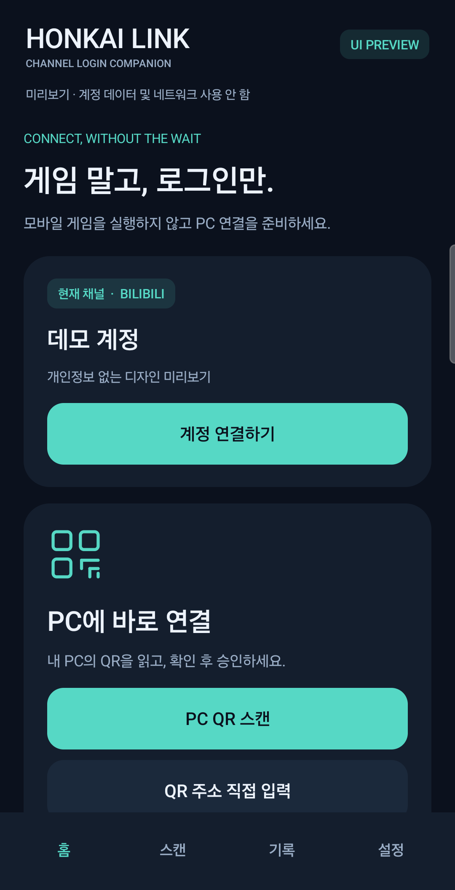
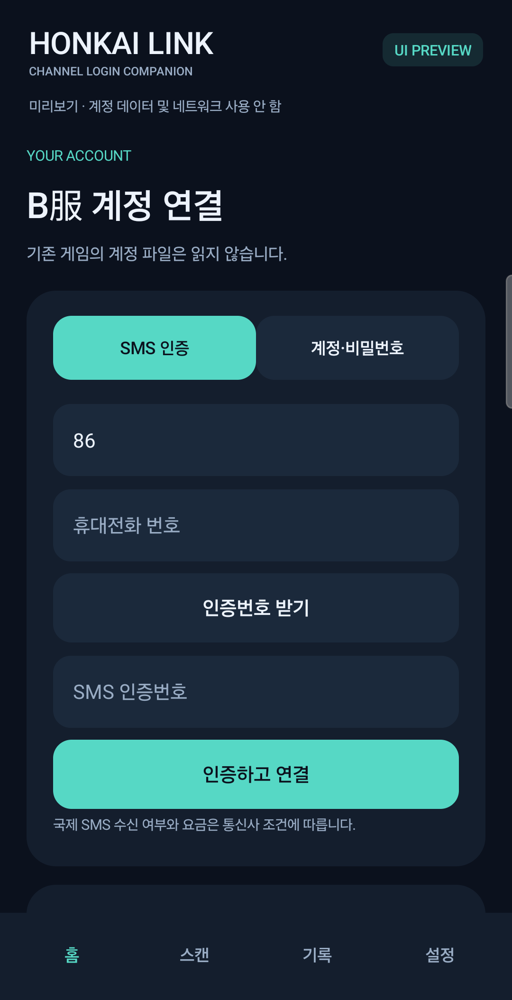
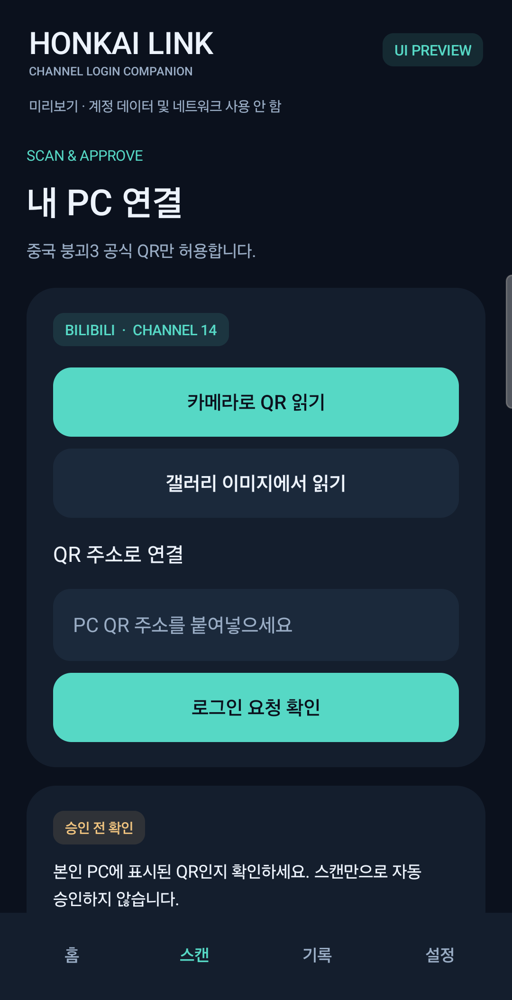

# HONKAI QR

**모바일 게임 대신, 가볍게 PC B服 로그인.**

중국 붕괴3 **Bilibili服(B服)** 계정을 연결하고 PC 로그인 QR을 승인하는 비공식 Android 도우미입니다.
게임의 업데이트 확인과 가로 화면 전환 없이, 계정 인증과 QR 연결에 집중합니다.

[**APK 다운로드 · 0.7.0-beta**](https://github.com/anycall6779/HI3CH_loginscanner/releases/tag/v0.7.0-beta) · [자세한 사용·빌드 안내](README.ko.md) · [개인정보 처리](PRIVACY.ko.md)

> **시험판 안내:** Android 8.0 이상. 게임 **9.1.0 · Bilibili服**에서 새 설치 후 실제 PC 접속을 확인했습니다(2026-11-13). 모든 소셜 인증이나 다른 채널의 로그인을 지원하는 완성판은 아닙니다.

## 화면 미리보기

아래는 **0.6 개발판을 실제 기기의 개인정보 없는 `UI PREVIEW` 모드에서 촬영한 화면**입니다. 계정은 데모이며 실제 전화번호·인증번호·로그인 QR을 포함하지 않습니다. 현재 0.7 시험판은 브랜드가 **HONKAI QR**로 바뀌었고, 설정 서비스 동의·게임 버전 변경이 추가되어 일부 문구가 다릅니다. 이미지는 화면 구성을 설명하기 위한 것으로 로그인 성공 증거가 아닙니다. 휴대폰 상단 상태바와 하단 시스템 내비게이션 바는 제외했으며 앱 내부 탭은 유지했습니다.

<table>
  <tr>
    <th>01 · 홈</th>
    <th>02 · 계정 연결</th>
    <th>03 · PC QR 연결</th>
  </tr>
  <tr>
    <td></td>
    <td></td>
    <td></td>
  </tr>
  <tr>
    <td>계정을 연결하고<br/>PC QR 스캔으로 바로 이동합니다.</td>
    <td>원하는 인증 방식을 선택하고<br/>앱 안에서 직접 인증합니다.</td>
    <td>QR을 읽은 뒤 본인 PC인지<br/>확인하고 명시적으로 승인합니다.</td>
  </tr>
</table>

## 주요 기능

| 기능 | 설명 |
| --- | --- |
| B服 계정 연결 | SMS·계정/비밀번호 인증 경로. 소셜 인증은 서버 제공 여부에 따라 표시하며 미검증 항목이 있습니다. |
| QR 판독 강화 | 고해상도 카메라, 다중 영역 탐색, 저명암 처리, 자동·수동 확대. 실제 인식 거리는 카메라와 PC 화면 환경에 따라 달라집니다. |
| 세 가지 QR 입력 | 카메라 스캔, 시스템 선택기의 이미지, QR 주소 붙여넣기. |
| 기기 내 다중 계정 | 최대 20개 프로필, 계정 전환·별칭·개별 삭제. Android Keystore와 AES-GCM으로 보관합니다. |
| 최소한의 이력 | 최근 50개의 승인 API 결과와 시각만 암호화 저장합니다. 실제 게임 접속 성공 기록과는 구분합니다. |
| 실시간 게임 설정 | 동의 후 원본 HonkaiScanner 설정 서비스를 조회합니다. 설정에서 게임 버전 변경과 동의 철회가 가능합니다. |

비밀번호·SMS 코드는 저장하지 않으며, QR 이미지는 기기에서 처리합니다. PC에 표시되는 로그인 이름은 **HONKAI QR**입니다.

## 사용 순서

1. 위 **APK 다운로드**에서 `HONKAI-QR-0.7.0-beta.apk`를 받아 설치합니다.
2. 첫 실행 시 **외부 설정 서비스 안내**를 읽고 사용 여부를 선택합니다. PC 승인에는 설정 조회 동의가 필요합니다.
3. **계정 연결하기**에서 본인의 B服 계정을 직접 인증합니다.
4. PC에서 중국 붕괴3 **Bilibili服** 클라이언트의 새 로그인 QR을 띄웁니다.
5. **PC QR 스캔**으로 읽고, 본인 PC의 요청인지 확인한 뒤 승인합니다. 카메라 외에 이미지·주소 입력도 사용할 수 있습니다.
6. PC에서 서버·캐릭터와 실제 게임 진입을 확인합니다. **승인 API 수락만으로 게임 접속 성공이 보장되지는 않습니다.**

기존 개발용 테스트 앱과는 별도 설치됩니다(`io.anycall6779.honkaiqr`). 기존 앱의 계정 파일을 가져오지 않으므로 새 앱에서 직접 인증해야 합니다.

## 설정 서비스와 지원 범위

- 설정 공급자는 **`api-v2.scanner.hellocraft.xyz`**입니다. **공식 서버 직접 조회가 아니라 원본 설정 서비스에 의존**하며, 장애나 응답 변경 시 승인이 중단될 수 있습니다.
- 설정 서비스에는 게임 버전과 고정 프로토콜 호환값만 보냅니다. **계정 ID·로그인 토큰·실제 기기 ID·QR은 보내지 않습니다.** 운영자는 연결 IP와 요청 시각을 볼 수 있습니다.
- 로그에서 가져온 임시 설정은 포함하지 않으며, 조회 실패 시 과거 설정으로 우회하지 않습니다. 설정 암호문의 구조는 검사하지만 내부 내용은 독립 검증하지 못합니다.
- 게임 업데이트 후에는 **설정 → 게임 버전 변경**에서 버전을 맞춰 주세요. 최신 버전 자동 탐색이나 향후 버전 호환은 보장하지 않습니다.
- Bilibili 소셜 SSO·복수 실제 계정·만료·추가 인증의 전체 검증은 완료되지 않았습니다. Apple은 서버에서 제공할 때만 활성화됩니다. 다른 채널 목록은 호환 안내이며 실제 로그인 지원이 아닙니다.

[설정 서비스 상세](DISPATCH.ko.md) · [기능별 지원 범위](FEATURES.ko.md) · [0.7 검증 기록](TESTS-0.7.ko.md) · [남은 검증](RELEASE-BLOCKERS.ko.md)

## 자주 묻는 질문

**QR이 잘 안 읽혀요.**  
PC QR을 새로 띄우고 초점을 맞춰 보세요. PC 화면 반사·흔들림을 줄이고 확대를 조절하거나 이미지 입력을 사용하세요. 원거리 인식에는 물리적인 한계가 있습니다.

**승인됐는데 PC 접속이 안 돼요.**  
B服 클라이언트인지, QR이 만료되지 않았는지, 앱의 게임 버전 설정이 맞는지 확인하세요. 설정의 실시간 설정 조회 검사·B服 게임 토큰 검사로 실패 단계를 구분할 수 있습니다.

**오류를 공유할 때 무엇을 빼야 하나요?**  
비밀번호, SMS 코드, 토큰, 계정 ID, QR 원문과 원본 로그인 로그는 올리지 마세요. 앱 버전·게임 버전·오류 문구 및 발생 단계만 알려주세요.

## 소스 빌드

JDK 17, Android SDK Platform 34, Build Tools 36.0.0, PowerShell이 필요합니다.

```powershell
.\build.ps1
```

Gradle 없이 javac/D8/aapt2/apksigner를 사용합니다. ZXing 의존성은 버전과 SHA-256을 고정합니다.
배포용 서명은 `-SigningKeystore KEYSTORE -SigningAlias honkaiqr`와 로컬 `HONKAIQR_STORE_PASS` 환경변수를 사용합니다. **서명 키·비밀번호를 저장소에 올리지 마세요.** 기본 디버그 서명 APK는 공개 시험판 APK를 덮어쓸 수 없습니다.

## 라이선스·고지

HonkaiScanner/bh3_login_simulation-memories의 공개 구현을 참고했습니다(MIT). ZXing core 3.5.3은 Apache-2.0이며 필요한 고지를 `licenses/`와 앱 내부에 보존합니다. 공급자 SDK 바이너리를 번들하지 않습니다.

공식 게임사·Bilibili·원본 설정 서비스와의 제휴를 의미하지 않는 비공식 프로젝트입니다.
